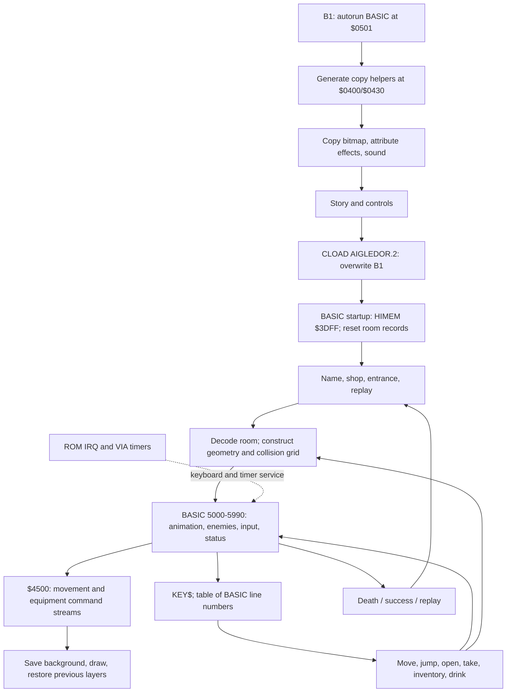

# Architecture and complete-image coverage

## Scope and evidence

Read [overview.md](overview.md) for provenance and the B1/B2 address-to-TAP
formula. Ranges below refer to loaded addresses, not assembly source lines.
Reconstructed BASIC listings retain exact original record locations. A valid
linear disassembly of data is not evidence that the data is executable.

## Execution graph

The application repeatedly CALLs short routines and gets control back with
`RTS`. It does not replace BASIC with a self-contained machine-code main loop.
Source evidence: B2 BASIC 0–50, 4000–5050 and 5100–5990; machine `$4500–$45FB`.

## Complete loaded-region ledger

Every loaded address falls in one of these regions. Broad asset/snapshot ranges
are a coverage declaration, not a claim that each byte's original meaning is
known. No material outside these two payloads was supplied.

### First stage

| B1 range | Classification / evidence |
| --- | --- |
| `$0501–$0F66` | 76 ordinary tokenized BASIC records, lines 0–1690; story, loading, graphics, audio and controls |
| `$0F67–$0F74` | Two structurally linked but anomalous tail records, numbered 32849 and 33792; not meaningful application routines |
| `$0F75–$0F76` | Zero next-line sentinel |
| `$0F77–$17FF` | Captured non-program state / strings / padding; BASIC line 0 sets VARTAB to `$0F69`, so runtime variable allocation also overlaps tail material |
| `$1800` | Prefix byte before the copied bitmap; pointer convention skips it |
| `$1801–$3740` | Exactly 8,000 bytes copied to `$A000–$BF3F` by generated helper; title graphic including attributes |
| `$3741–$3F37` | Additional captured data / padding, no application consumer established; preserve as unresolved |

Generated code at `$0400–$0426` and `$0430–$0456` is not a third tape block.
BASIC lines 20–52 build it by decoding hexadecimal strings. The helper copies
rows indexed `Y = width ... 1`, then advances source by width and destination
by `$28`. B1 line 1010 initializes source `$1800`, destination `$9FFF`, width
`$28`, height `$C8`; both skipped prefix bytes explain the real copied ranges.

### Main stage

| B2 range | Classification / evidence |
| --- | --- |
| `$0501–$3BFD` | 464 BASIC records, including fallback line 21845 at `$3BF4` |
| `$3BFE–$3BFF` | Zero next-line sentinel |
| `$3C00–$3DFF` | Captured BASIC state, variables and strings; VARTAB set to `$3C00` and HIMEM to `$3DFF` |
| `$3E00–$3F08` | Arithmetic, descriptor access, rendering and coordinate routines; includes inactive/uncertain restoration entry `$3EF1` |
| `$3F09–$3F0A` | Unresolved two-byte remnant (`$CF,$3E`), not a proved routine |
| `$3F0B–$3FF1` | Bit extraction and room decoder |
| `$3FF2–$3FFF` | `$55` padding |
| `$4000–$411F` | Attribute-capable renderers and torch/equipment update |
| `$4120–$412F` | Eight pairs of equipment position offsets used by `$4109–$4117` |
| `$4130–$413F` | Zero-filled gap |
| `$4140–$416D` | Save-under entry and software delay |
| `$416E–$41FF` | `$55` padding |
| `$4200–$42FF` | Movement-stream pointer table and unused/overlapping remnants; only used indices are meaningful |
| `$4300–$43FF` | 128 little-endian BASIC line-number dispatch entries indexed by ASCII key × 2 |
| `$4400–$4433` | 26 little-endian equipment-stream pointers |
| `$4434–$44FF` | Padding |
| `$4500–$45FB` | Animation command interpreter and restoration |
| `$45FC–$468B` | Non-game BASIC-looking text, including employment/university statistics; captured residue, no live consumer identified |
| `$468C–$46B9` | Padding |
| `$46BA–$46FF` | Partial duplicate of interpreter code, orphan/remnant candidate; do not count as active without a trace |
| `$4700–$483F` | Motion/equipment command streams and gaps |
| `$4840–$4858` | Save-under entry with attribute emission |
| `$4859–$4958` | More equipment/motion streams and gaps |
| `$4959–$495B` | Padding |
| `$495C–$4B3D` | Enemy restoration, spawning/drawing, movement, pursuit, idle motion and termination |
| `$4B3E–$4B3F` | Padding |
| `$4B40–$4DC4` | Pointer arithmetic, coarse collision and jump checks, interspersed padding and an older helper at `$4B50` |
| `$4DC5–$4DDC` | Equipment stream at `$4DC6`, plus padding |
| `$4DDD–$4F06` | Reset room data, clear charset area, victory picture, another static display, charset save/restore |
| `$4F07–$4FFF` | Padding |
| `$5000–$51FF` | Mutable room records: 64 × 4 bytes in each of two tables |
| `$5200–$55FF` | Saved-background slots `$F3–$F6`; data plus retained initial contents |
| `$5600–$57FF` | Initial room-record backup restored to `$5000–$51FF` on RUN 1 |
| `$5800–$59FF` | Saved-background slots `$F9/$FA`; `$5900` is also reused for charset preservation in a separate mode |
| `$5A00–$5C04` | Backslash-terminated message strings; victory positions `$5B00–$5B0B`, score/name data near `$5BBD` intermixed |
| `$5C05–$5C30` | Gap/captured bytes after the name area; no independent executable entry established |
| `$5C31–$5C69` | Second scroll's 56 content bytes plus backslash sentinel; BASIC 10810 uses decimal address 23601 |
| `$5C6A–$6523` | Mostly padding and captured bytes before atlas; no independent executable entry established |
| `$6524–$9400` | Sprite/image atlas, referenced by descriptors; gaps/residual bytes included, and the last image byte shares descriptor-table entry 0 |
| `$9401–$97FF` | Remaining width table, height table, source-low and source-high tables; 256 entries per field |
| `$9800–$9FFF` | Loaded character-set region; display mode/ROM transfers determine live location and ownership |

This classification prevents misleading discoveries such as treating `$55`
padding as an `EOR $55,X` optimization, animation bytes as undocumented opcodes,
or residual BASIC text as a missing game subsystem.

## Runtime ownership and allocations

| Address / range | Owner and meaning | Evidence / caveat |
| --- | --- | --- |
| `$0000–$00FF` | ROM/BASIC workspace plus shared game temporaries | Not an exclusively application-owned zero page |
| `$0010–$0011` | ROM graphics cursor address imported by renderer | `$3E18–$3E20`; not preserved across arbitrary ROM calls |
| `$0060–$0067` | Source, screen and saved-background pointers | `$3E3B`, `$3E52`, `$3E78` |
| `$0064/$0065` | Width and rows remaining, destructively consumed | Descriptor loader and row loops |
| `$0068–$006C` | Image ID, byte-column, scanline, save-slot ID, emitted attribute | BASIC 90/98 and machine draw paths |
| `$0070–$0075` | Arithmetic scratch/result and command-stream pointer | `$3E00`, `$4500` |
| `$0078–$007B` | Collision pointer and two saved graphic bytes | `$4CB6`, `$4CDD` |
| `$0100–$01FF` | 6502 hardware stack, BASIC/ROM/game call nesting | No game-owned stack relocation identified |
| `$0200–$02FF` | ROM state and timers | Explicit accesses include `$0219/$021A`, `$026A`, `$0276`, `$02C0` |
| `$0306–$0307` | VIA Timer 1 latch | BASIC 3000/4000/9030 writes; not a RAM allocation |
| `$0400–$0477` | 120-byte semantic collision grid, three rows × 40 columns | Cleared by `$3F14`; populated by BASIC 600–940 |
| `$0478/$0479` | Actor byte-column and scanline | BASIC 7–8; movement `$4590`; collision `$4CB6` |
| `$047C–$0494` | Decoded room flags, objects and exits | `$3F14–$3FF1` |
| `$0495` | Current room index | BASIC 4010/4705; index constrained to six bits at transitions |
| `$0497–$04AB` | Torch/equipment state, action, facing, pose and animation cursors | BASIC 7–8; `$40C8`, `$4500`, `$45AA` |
| `$04B0–$04B6` | Enemy contact/state, x/y, direction, frame, type | BASIC 6400/8000; `$4976–$4B3D` |
| `$04C0–$04C8` | Collision/action results, door state, obstacle flag, jump-check storage | `$4C73`, `$4CDD`, `$4D55` |
| `$04D0` | Attempt/player counter surviving RUN 1 | BASIC 0/42/9050 |
| `$0501–$3BFF` | BASIC program | Supplied records |
| `$3C00–$3DFF` | Nominal 512-byte BASIC variable/array/string window | B2 lines 0–1; actual free heap and peak stack usage unmeasured |
| `$3E00–$97FF` | Resident code, tables, images, save buffers | See region ledger; not uniformly executable |
| `$9800–$9FFF` | HIRES character-set location | Contains stage-2 data; mode switching uses ROM services |
| `$A000–$BF3F` | 8,000-byte HIRES display | All renderers use 40-byte row stride |
| `$B400–$BB7F` | TEXT charset area; overlaps HIRES display | Explicitly cleared by `$4E00`; ROM/mode lifetimes matter |
| `$BB80–$BFDF` | TEXT display area, overlapping part of HIRES region | Never simultaneously free application RAM |
| `$BF68–$BFDF` | HIRES bottom text/status area | ROM/BASIC text output; bitmap ends earlier at `$BF3F` |

The program contains no general-purpose allocator. Tables, buffers and variables
have fixed addresses and carefully separated lifetimes. ROM zero-page conflicts,
the small BASIC heap and overlapping video/charset areas are constraints requiring
runtime validation, not evidence that these addresses are safe for another game.

## Packed room data

`$3F14` computes `X = 4 * room`, reads four bytes at `$5000+X`, then four at
`$5100+X`. Six-bit room IDs therefore fit a page of four-byte records. Field
decoding uses rotations through carry; the destination flag area is cleared
first so single-bit flags do not retain prior values.

| Source field | Unpacked destinations / interpretation |
| --- | --- |
| `$5000+4*r`, bits 7–6 | `$0481`: geometry class, selects BASIC 200/300/400/500 |
| Same byte, bits 5/4/3/2 | `$0480/$047F/$047E/$047D`: feature flags |
| Same byte, bits 1–0 | `$047C`: torch/light feature class |
| Next byte, four two-bit groups, high first | `$0485/$0484/$0483/$0482`: feature/door-related classes |
| Third byte, high-first pairs | `$0489/$0488/$0487/$0486`: enemy/event fields |
| Fourth byte, high-first pairs | `$048D/$048C/$048B/$048A`: door/lock fields |
| `$5100+4*r`, bits 7 and 6 | `$0491/$0490`: mutable trap/feature state |
| Same byte, bits 5–3 / 2–0 | `$048F/$048E`: treasure and furnishing classes |
| Remaining three bytes | `$0492–$0494`: packed transition codes |

BASIC 4702 interprets a transition byte as destination `value AND $3F` and
arrival direction `(value AND $C0)/$40`. The exact relationship between the
three stored transitions and all four actor directions includes current-room
state and special cases; do not assume four independent links per record.
BASIC 6300, 7000, 10716 and 10962 modify packed bits in place. `$4DDD` restores
the two pages from immutable-in-session backup `$5600–$57FF` for replay.

## Sprite descriptors and saved backgrounds

For ID `i`, width is `$9400+i`, height `$9500+i`, source low `$9600+i`, source
high `$9700+i`. `$3E3B` loads all four into zero-page state. Ordinary images
and saved backgrounds use the same representation. Pages are aligned and
indices are bytes; no indexed-read page crossing occurs in these field loads.

The source and destination pointers denote the byte **before** the first
copied byte. Each row copies offsets `width ... 1`. Source advances by width;
display advances by 40. Runtime save-slot IDs `$F3–$F6,$F9,$FA` have pointers
to page bases `$5200,$5300,$5400,$5500,$5800,$5900`. The last two bytes of
each page retain byte-column/scanline coordinates at offsets `$FE/$FF`, used
when erasing the corresponding layer. Draw/erase order and buffer reuse are
part of correctness; this is not arbitrary overlap-safe compositing.

## Animation command language

`$4500` selects the movement stream through `$4200 + 2*$0498`, stores it in
`$74/$75` and resumes from cursor `$04A0`. `$45AA` selects equipment animation
through `$4400 + 2*$04A3` and cursor `$04A9`. A stream's byte at offset zero
is a prefix; command fetch pre-increments the cursor. Movement/equipment IDs
are not the same as sprite IDs.

| Command | Bytes consumed / effect | Decoder evidence |
| --- | --- | --- |
| `$80–$FF` | One byte: restore a background identified by the byte | `$4516–$451D`, `$4574–$458C` |
| `$00` | Three bytes total: add signed byte deltas to actor x/y modulo 256 | `$4590–$45A9` |
| `$14` | Yield point; set `$04A7` then process the equipment stream | `$4525–$452B`, `$45AA` |
| `$15` | Busy-wait `$415C`, then keep interpreting | `$452D–$4536` |
| `$16` | Action/event yield point, also enters equipment stream | `$4537–$453D` |
| `$17` | Two bytes: select another movement ID, reset cursor, restart | `$453F–$454F` |
| Other positive byte | Four bytes total: save-slot offset, x/y offsets, sprite ID; save and draw | `$4551–$456E` |

The save-slot offset is added to `$F2`; offset 1 selects `$F3`. The equipment
decoder supports its own draw records and `$14` terminator, with a pose-dependent
y adjustment. It does not implement every movement opcode. A high-bit first
byte is a restore command rather than a draw-slot selector. The fourth field of
a drawing record is a sprite ID and can itself have its high bit set; these two
roles must not be confused.

Several commands can execute in one CALL. Yield markers produce resumable
frames without one machine routine per animation. `$04A7` communicates events
to BASIC, e.g. BASIC 5017 and 5020. No bound checking or malformed-stream recovery
was identified; the byte cursor wraps at 256. There is no evidence of a generic
compression/decompression algorithm: the streams are compact instructions, and
image copying is direct byte copying.

## Algorithms and subsystem boundaries

Rooms combine four geometry classes drawn with ROM primitives and repeated
atlas pieces. Furnishings and mutable state select overlays. Collisions consult
the separate three-row grid, not bitmap pixels. Moving layers save and restore
background rectangles. Enemies use bounded byte arithmetic, rough distance
checks and timer-derived variation, while BASIC determines spawning, damage
and sound. Text walks backslash-terminated strings and invokes `CHAR` with
six-pixel advances, wrapping by eight scanlines (BASIC 9100–9130).

Audio and keyboard scanning stay in ROM; custom raster interrupts, direct AY
drivers, full-screen scrolling, double buffering and disk loading were not
identified. A lack of application IRQ code does not mean interrupts are disabled.

## Remaining uncertainties

Complete runtime command reachability, exact font relocation effects, ROM
register/zero-page side effects, padding provenance, malformed loader-tail intent
and inactive code remnants need source recovery or tracing. These limitations
are retained throughout the dossier rather than replaced by invented labels.
