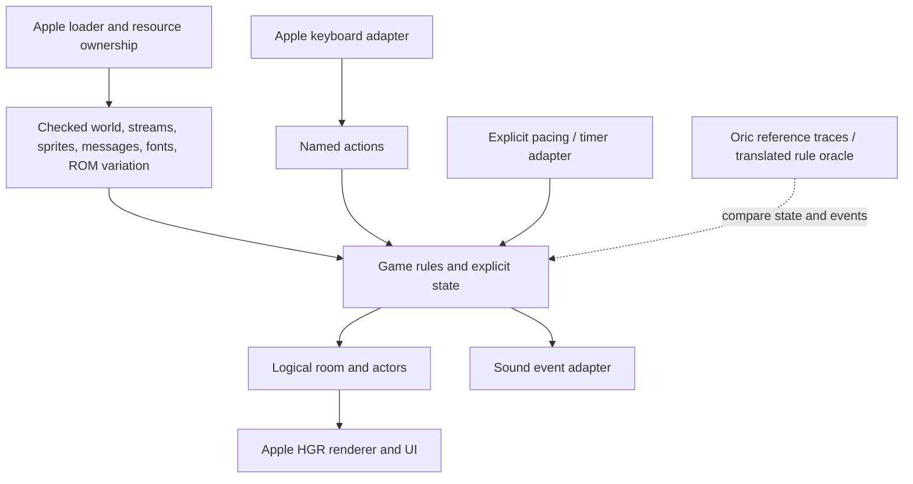

# L'Aigle d'Or: reproducible Oric to Apple IIe porting workbook

## 1. Objective, scope and reading order

Implementation update: the [Apple IIe project](../../../ports/laigle-dor/apple-iie/README.md)
now supplies native boot images, room 12, original actor images, keyboard,
collisions and silent events. Its [W00–W06 status](../../../ports/laigle-dor/apple-iie/docs/work-packages.md)
and [verification](../../../ports/laigle-dor/apple-iie/docs/verification.md)
distinguish executed target checks from the source-runtime gates still pending.
The inventories and acceptance matrix below remain the full-port contract,
not a claim that the entire game is implemented.

Reproduce this game's rules, world and observable actions on an explicitly
configured Apple IIe. This document inventories the mechanics found in the
two supplied tape programs and turns their implementation dependencies into
work packages and acceptance checks. It supplements the original analysis;
it does not replace source listings or certify a completed port.

The inventory covers the normal B1 introduction, every B2 BASIC subsystem,
the established machine-code workers, referenced tables, graphics, messages,
firmware, input, sound and timing. Complete runtime reachability, every sprite
and ROM-dependent room variant are not yet established. Unresolved remnants
are identified separately from required gameplay. The original inventory was
prepared without executing either game. Later target prototype execution is
recorded in the linked implementation verification.

Read this in order: [evidence](#2-evidence-and-reproducibility-baseline),
[target decisions](#3-target-profile-and-proposed-design),
[gameplay inventory](#4-gameplay-mechanics-and-state),
[implementation mechanisms](#5-implementation-mechanisms-and-adaptations),
[reproduction workflow](#6-reproducible-workflow),
[acceptance tests](#8-verification-and-acceptance-matrix).

Evidence labels used here:

- **Source-confirmed / analyzed:** an expression, byte sequence or data access
  is established in the supplied image. This is not a runtime observation.
- **Documented constraint:** supported by a primary machine/language reference.
- **Proposed:** an implementation choice for this port, not a validated existing
  engine or a benchmarked optimization.
- **Unresolved:** a value, complete contract, intent or runtime path needs testing.

## 2. Evidence and reproducibility baseline

### 2.1 Historical inputs and exact references

| Field | Pinned evidence |
| --- | --- |
| Program / attribution | L'Aigle d'Or; B1 line 100 credits ROCQUES Louis-Marie; B1 lines 3–4 identify Loriciels, March 1984 and a reproduction restriction |
| Original input | [Original TAP](<../../sources/Oric/L'Aigle d'Or/Aigle D'or, Le (1984)(Loriciels).tap>) |
| Original SHA-256 | `7f01e1a3d05825aab887952cd5711bea69d6525730aba5c1e25c814334fe77d7` |
| Exact extraction | [manifest.json](extracted/manifest.json), [extraction guide](extracted/README.md) |
| B1 | [aigledor.1.bin](extracted/aigledor.1.bin), 14,903 bytes at `$0501–$3F37`; [BASIC listing](extracted/aigledor.1.basic.txt) |
| B2 | [aigledor.2.bin](extracted/aigledor.2.bin), 39,679 bytes at `$0501–$9FFF`; [BASIC listing](extracted/aigledor.2.basic.txt) |
| Language / toolchain | Oric tokenized BASIC and documented NMOS 6502 bytes; original assembler source and dialect unavailable |
| Source model | 48 KiB Oric configuration; intended ROM adaptation exists, but exact Oric-1/Atmos runtime equivalence is unverified |
| Licensing / provenance | Original download origin and code-reuse license unknown; keep historical attribution/restrictions with extracted material |

The two stages occupy the same load base; B2 replaces B1. Their sizes are not
two simultaneous RAM allocations. The payloads also contain captured state,
padding and data, so a `.bin` file is not a relocatable assembly object.

`B1 n` and `B2 n` below mean **original BASIC line number n**, not the physical
line number in the analytical text. Each listing record also prints its CPU
address and original TAP offset. Machine ranges are inclusive. Convert a loaded
address `a` to zero-based original tape offset with:

```text
B1: TAP(a) = $000018 + (a - $0501)
B2: TAP(a) = a + $3566
```

Names such as `RoomState` or `draw_sprite` in this workbook are proposed names,
not recovered historical symbols. The [routine inventory](routines.md) supplies
the detailed relationships and entry points.

### 2.2 Existing evidence and missing baseline

[verification.json](verification.json) and
[integration-verification.json](integration-verification.json) cover byte
preservation, BASIC links and selected arithmetic/copy/representation models.
They are neither CPU-emulator executions nor gameplay or performance tests.

A faithful reference run still requires a named Oric model, exact ROM hash,
emulator/hardware configuration, initial state and input trace. In particular,
**B2 line 607 reads `M = PEEK($D000 + current_room)`**. The resulting 64-byte
ROM-derived variation table is not contained in either tape payload. Its callers
use M for object/clue placement, gate side and chest-opening conditions (720,
790–799, 882, 902/962, 7048, 10950). Capture `$D000–$D03F` from the selected
reference ROM and identify its hash before claiming the original room behavior.
Reading those addresses from Apple ROM would generate a different game.

This is a source-confirmed dependency. The correct values for the intended
release/model remain unresolved. The renderer at line 730 tests temporary V,
not M; preserve the actual expression in a reference model rather than silently
substituting an assumed intended variable.

## 3. Target profile and proposed design

### 3.1 Decision register

The existing [Apple IIe profile](<../../../docs/machines/Apple/Apple IIe/README.md>)
does not establish a particular physical CPU, ROM or memory expansion. Fill the
following before implementing hardware-specific code; proposals are starting
points, not properties inferred from the user's machine.

| Decision | Proposed first prototype | Must be recorded / verified |
| --- | --- | --- |
| CPU | Documented NMOS 6502 instruction subset | Actual CPU/enhancement status; separate 65C02 timing/bus review if applicable |
| Memory | Main RAM, explicit link map | ROM/OS/zero-page/stack owners; auxiliary RAM and bank state if used |
| Video | Ordinary mixed HGR, monochrome: 160 graphics rows plus four text rows | Selected page, output/standard, viewport/HUD allocation, initialization |
| Page strategy | Two alternating frame/text pages, per-page dirty repair and a third terrain baseline | Current W06 implementation; complete workload/physical timing and full-game RAM budget remain to be checked |
| Input | Keyboard actions | Actual Apple key codes/strobe behavior; normalization, repeat and release policy |
| Audio | Silent first gameplay prototype; event logging | Later speaker synthesis or explicitly required sound card; measured latency |
| Storage | Trusted Apple loader chosen explicitly | Boot/OS/media format, slots, workspace, error handling and asset load ranges |
| Game implementation | Explicit portable state/rule model plus Apple-specific workers | Language/assembler/linker, callable ABI and numeric/RNG compatibility policy |
| Fidelity | Preserve logical coordinates, event ordering and world mutations | Timing tolerance, numeric differences and deliberate bug fixes documented separately |

No code placement or universal free-zero-page addresses are assigned here.
This workbook does not require double-HGR, auxiliary RAM, an accelerator or an
audio expansion by default. A complete-game memory fit is not established.

### 3.2 Proposed module boundaries



The original BASIC controller is a useful rule specification. Options include
an Applesoft controller with machine workers or a standalone reimplementation.
Either needs translated commands, storage, state and numeric contracts; neither
can load the tokenized Oric BASIC unchanged. The proposed standalone boundaries
avoid retaining accidental fixed addresses and private Oric ROM entries. They
are design choices, not claims of better performance.

## 4. Gameplay mechanics and state

### 4.1 Complete subsystem inventory

Mechanic IDs M01–M27 are local checklist identifiers, not new knowledge-base
technique IDs. All source descriptions are static `analyzed` evidence. The
implementation/test column describes work still to be performed.

| ID / mechanic | Original evidence | Behavior to preserve | Apple adaptation / acceptance check |
| --- | --- | --- | --- |
| M01 Introduction, story, credits and controls | B1 0–1690; generated `$0400` helper | Title bitmap, attribute effects, three transposed tune passes, story/control pages, then load B2 | Convert title/effects and UI; retain credits; test complete startup progression |
| M02 New game and initialization | B2 0–50; `$4DDD–$4DFD` | RUN 1 clears BASIC variables; room pages reset from backup; initialize energy 100, drain .01, money 500 and three objectives still present | Explicit initialization/reset; separate attempt history from per-game state; test replay isolation |
| M03 Exterior menu and entering/leaving | B2 3000–3070, 4000–4010, 4701 | Start in room 12 on entry; leave through the room-12/direction-3 special path; merchant and departure outcomes | Named menu/scene states; preserve exit condition and objective-dependent messages |
| M04 Room construction and room persistence | B2 100–1999, 4010, 4702–4710; `$3F14–$3FF1` | Four geometry classes, packed room features, furnishings, gates, objects and persistent changes; ROM-derived M influences details | Decode 64 slots and capture ROM variation; compare room properties and rendered reference scenes |
| M05 Walking, turning, stopping and crouching | B2 10000–10510; 4900–5050 | Four facing codes, neutral/crouched poses, turn-before-walk behavior and continuing movement when no new key is returned | Action state machine in logical coordinates; test all facing/pose/action combinations |
| M06 Collision and object/door probes | B2 5, 600–940, 4800–4810, 10703; `$4B75–$4CDC` | Three 40-cell semantic rows; blocked cells, object marks and door results; special y-to-row mapping | Separate logical grid with explicit bounds/results; compare each directional probe before changing granularity |
| M07 Doors, locks and ordinary room transitions | B2 4600–4710, 10900 | Lock-field test, iron-key exception, crowbar wear/chance, destination/arrival bits and scene reconstruction | Explicit door/exit contract; preserve three stored links plus current-room special case, not four invented links |
| M08 Horizontal jump | B2 10600–10690, 5017–5018; `$4D55–$4DC4` | Direction/collision precheck, temporary empty hand, retained equipment, PM event milestones at 1/4/5 and gate-jump state | Event-driven action with exact precheck/restoration order; test blocked jump, gear restoration and gate interaction |
| M09 Vertical jump / staged special action | B2 12300–12360, 5019/5210 | SD-driven sequence: crouch/neutral stages, three y−13 steps, light interaction, three y+13 steps and reset | Explicit stage sequence; test total displacement and interruption by the active moving hazard |
| M10 Rope use and climbing | B2 7200–7450, 5027/5037 | Requires ropes and empty hand; consume one rope; GP stages, rope drawing and temporary descriptor change; special room 62→63 or return from a pit | Logical climb state plus draw events; test inventory decrement once, all phases and correct return room/x |
| M11 Falling gate / grille trap | B2 900–992, 5015–5018, 6300–6320 | Side marker establishes HS; HT marks a jump interaction; activate persistent gate bit; death if HT is zero | Keep trigger/event ordering; test successful jump and fatal unprotected trigger on both sides |
| M12 Floor trap and oubliette | B2 790–799, 5025, 6900–7060, 7100 | Object-map marker/event causes fall; mark persistent bit, remember AP/AX, apply energy/drain effects, restrict initial input to A | Separate pit scene/state; test ignored initial keys, room/x restoration and depleted ropes |
| M13 Moving horizontal hazard | B2 6200–6240, 10787; `$4CDD–$4D50` | Two-byte hazard advances, restores old pixels and signals damage; damage lowers energy and raises drain | Logical hazard with target drawing; preserve repeated update-call ordering before selecting a new cadence |
| M14 Enemy spawning, movement and damage | B2 6400–6470, 8000–8220; `$495C–$4B3D` | Spawn from room fields; two active families; bounded movement/pursuit/contact, two-frame choice, torch/timer and pose-sensitive damage | Separate enemy state/rules from graphics and timer reads; compare spawn/contact traces for both families |
| M15 Strength/energy, fatigue and HUD | B2 5200, 5700–5990, 6220, 7047, 8115, 8200 | EO decreases by BL on controller passes; traps/enemies increase BL; display integer EO, points, gold and held item; death at EO<0 | Define numeric precision and logical update opportunities; test EO=0 versus negative and cumulative losses |
| M16 Equipment selection and wear | B2 2300–2420, 5110, 11000–11520 | Empty hand, torch, iron/gold key, vial, crowbar; torch decrements DT while selected; crowbar decrements DP on specific uses; consume exhausted item | Preserve item availability, hand/pose visuals, threshold <0 and replacement lifetimes |
| M17 Darkness and lighting wall fixtures | B2 6000–6100, 12000–12035; `$40C8–$411F`, `$4EEA–$4F06` | Dark-state UI, torch exceptions, left/right fixture bits, visual phase and persistent room bit; restore scene when light returns | Visibility state and light fixtures; implement display effect independently of charset clearing; test enter/leave dark rooms |
| M18 Inventory display | B2 2500–2599 | Equipment quantities, acquired objectives, ring, lead eagle, scroll count and keys; three objective flags use inverted possession logic | Preserve inventory semantics and returning controller state; test before/after each acquisition |
| M19 Ordinary treasure pickup | B2 10700–10777 | Position/facing/pose/empty-hand gates; seven treasure classes; clear treasure bits once and erase object | Data-driven reward table and transaction; test denied pickup, single reward and persistence after re-entry |
| M20 Book, diamond and eagle quest | B2 645–655, 10780–10799, 6500–6520 | Special rooms/positions; book in 1, diamond in 62, gold eagle in 63; lead eagle required for the embedded gold eagle; quest hazards and feedback | Explicit quest interactions; test prerequisite, swap/removal, rewards, trap activation and objective completion |
| M21 Scroll/book reading and clues | B2 10800–10840, 9100–9130 | Three acquired-scroll flags and acquired-book text; German-language clues; backslash terminators and reading pauses | Export all referenced strings including `$5C31`; preserve content/font and availability conditions |
| M22 Drinking and poisoned vials | B2 12100–12130, 10742; 5035 | Held vial and stock required; FG stages; consume vial; PN tracks poisoned pickups from rooms 14/38; restorative/poison branch changes EO/BL | Preserve source predicate and staged consumption; test PN=0 and positive, no stock and interrupted action |
| M23 Chests and secret passages | B2 771–778, 10770/10775, 10907–10990, 10405 | Chest opening depends on M/held item, modifies room state and may wear crowbar; special gold-key action creates passage flag PS and alternate entry | Preserve exact actor conditions and persistent/transient distinction; test both chest access paths and passage transitions |
| M24 Merchant economy | B2 13000–13510 | Vials 360, torches 190, ropes 110, crowbars 230 gold; insufficient funds reject; first torch/crowbar creates random lifetime | Purchase transaction and menu; test exactly enough/one-short funds, quantities and first-item lifetime |
| M25 Exit and victory | B2 3000, 3030–3092; `$4E2A–$4E90` | Full victory requires AI=DI=LI=0 on reaching exterior menu; partial departure messages differ; victory picture then terminal loop | Preserve the three-objective predicate, partial outcomes and artwork; decide restart/quit convenience explicitly |
| M26 Death, suicide, names and replay | B2 9000–9050, 12200, 40–50, 3070 | Stop effects, restore darkness font if needed, draw memorial/name slots, five-attempt counter wrap, RUN 1 replay; suicide sets EO=0 before later drain | Explicit death/replay states and session history; test counter wrap, name truncation, dark death and actual EO threshold |
| M27 Randomness and pacing coupled to controller paths | B2 RND/WAIT/KEY$/CALL sites; timer reads in enemy code | RNG affects money, wear, unlocking, spawning, damage and effects; hazard/enemy/service calls occur at multiple points, not once per proven frame | Capture RNG/timer/input call order and reference pace; separate proposed target scheduling from faithful source behavior |

### 4.2 Actions, keys and compatibility exceptions

B1 1515–1570 documents most keys. The actual B2 table at `$4300–$43FF`, read
by line 5050, maps ASCII codes to **BASIC line numbers**, not machine addresses.
The following mappings were reread from the pinned payload:

| Source key / code | BASIC target | Action |
| --- | ---: | --- |
| Left `$08` | 10300 | Direction code 2 / left turn or walk |
| Right `$09` | 10200 | Direction code 1 / right turn or walk |
| Down `$0A` | 10100 | Direction code 0 / turn or walk |
| Up `$0B` | 10400 | Direction code 3 / turn or walk |
| Space `$20` | 10000 | Stop / neutral pose |
| A | 10500 | Crouch |
| B | 12100 | Drink |
| D | 12300 | Vertical staged action |
| G | 7200 | Rope / climb |
| I | 2500 | Inventory |
| L | 10800 | Read acquired clues/book |
| O | 10900 | Open door/chest/passage |
| P | 10700 | Take object |
| Q | 12200 | Suicide request |
| S | 10600 | Horizontal jump |
| T | 12000 | Light wall fixtures; present in table, absent from B1 help |
| 0 / 1 / 2 / 3 / 4 / 5 | 11000 / 11100 / 11200 / 11300 / 11400 / 11500 | Empty hand / torch / iron key / gold key / vial / crowbar |

Additional source aliases are `)`→empty, `!`→torch, `@`→iron key, `#`→gold key,
`$`→vial and `6`→crowbar. Decide their target keyboard equivalents explicitly.
Do not assume the Apple arrow codes equal Oric's. The source generally compares
uppercase keys; uppercase normalization on Apple is a proposed compatibility
choice, not an observed source feature.

Ordinary unassigned entries contain `$5555` (line 21845, GOTO 5100). One
exception, `>` / ASCII `$3E`, has word 21827 (`$5543`) at CPU `$437C`, TAP
`$0078E2`; that line is absent from the linked BASIC program. This is an
unresolved table anomaly, not an established extra action. Use an explicit
unknown-action policy in the port and keep this difference in its compatibility
log. Name/menu input is separate from in-game action dispatch.

### 4.3 State dictionary and reset ownership

These are historical variables/addresses, not Apple allocations. The proposed
model gives each a distinct field or derives it explicitly; BASIC scratch values
such as V/W/X/M must not become accidentally shared renderer/rule state.

| State group | Original storage | Meaning / important constraints |
| --- | --- | --- |
| Location and geometry | NP, SP; `$0495`, `$0481` | Current room and one of four geometry classes |
| Actor position | XH/YH; `$0478/$0479` | Byte-column / logical scanline, independent of target HGR pixels |
| Facing and pose | SS/PO; `$04A1/$04A2` | Facing 0–3; crouched poses 4–7; other action poses; transient SS=−1 is alternate-entry dispatch, not an array index |
| Action / movement | AC/MO; `$04A4`, `$0498` | Stop/walk, jump AC=5, drink AC=9 and selected movement stream |
| Held equipment | AB/AR/BR/BR$; `$04AB/$04A6/$04A3` | Logical item, visual family, facing-dependent equipment stream and UI label |
| Animation progress | `$04A0/$04A9/$04A7` | Two stream cursors and yielded event `$14/$16` |
| Collision / doors | V/ST/OB; `$04C0/$04C2/$04C4` | Source result, door state and special floor/object marker; define named target results |
| Resources and score | EO/BL/FR/PT | Energy, drain per controller pass, gold, score; fractional arithmetic matters; money/score exceed byte range |
| Quantities | ZC/ZF/ZT/ZP | Ropes, vials, torches, crowbars; zero after new-game CLEAR unless acquired |
| Item flags | ZR/ZO/ZG/ZN | Iron key, gold key, ring, lead eagle; ring affects displayed features, not demonstrated immunity |
| Objective flags | AI/DI/LI | 1 means objective still in the world; 0 means gold eagle/diamond/book acquired |
| Clue / poison flags | M1/M2/M3, PN | Three scroll acquisitions; number of poisoned vial pickups tracked collectively |
| Wear | DT/DP | Fractional random torch/crowbar lifetimes, tested against <0 |
| Visibility / scene | VN/NV/PS/OU | Dark state, pending scene message, secret passage, pit scene |
| Trap state | HS/HR/HT/TB | Gate trigger/side/jump interaction and initial pit input restriction |
| Multi-stage actions | GP/SD/PM/FG | Climb, vertical action, horizontal-jump event stage and drink stage |
| Saved action context | AP/AX, MB/MR | Pit return room/x; equipment saved during jump |
| Enemy state | BE/F; `$04B0–$04B6`, `$0499` | Family/contact/lifetime/x/y/direction/frame; F toggles 0/1 under BASIC truth semantics |
| Room state | `$5000–$51FF`; decoded `$047C–$0494` | Mutable persistent record versus current-room decoded view |
| Room variation | M from `$D000+room` | ROM-derived byte influencing layout/rules; must become a pinned resource |
| Session history | NO/N$; `$04D0`, name slots | Attempt counter survives RUN 1 in RAM; per-game variables reset; six-character displayed names plus terminator |

RUN performs an automatic CLEAR: numeric variables become zero and strings
empty. Preserve this in `new_game()`, while retaining only the intended session
history. This language behavior is documented in the
[Atmos manual](https://library.defence-force.org/books/content/manual_atmos.pdf),
printed p. 20. Captured bytes at `$3C00–$3DFF` are not authoritative new-game
inventory values.

### 4.4 Items, rewards and exact rule boundaries

The TR entries below describe ordinary pickup handlers selected by line 10710.
Chest pickup at 10775 instead jumps to `10717+5*TR`, bypassing those handlers'
pose guards and sometimes earlier side effects. Test the actual chest domain
separately rather than applying the ordinary crouch requirement to every pickup.

| Item / event | Source | Logical result |
| --- | --- | --- |
| Scroll, TR=1 | 10720–10722 | Requires crouched pose; set M1 in room 62, M2 in 35 or M3 in 1 |
| Gold bag, TR=2 | 10725–10727 | Requires crouch; add INT(RND(1)*300) gold, add 10 points |
| Iron key, TR=3 | 10730–10732 | Requires crouch; ZR=1, +15 points |
| Gold key, TR=4 | 10735–10738 | Requires crouch; ZO=1, +30 points |
| Vial, TR=5 | 10740–10743 | Requires crouch; ZF+=1, +7 points; PN+=1 in rooms 14/38 |
| Ring, TR=6 | 10745–10747 | Requires crouch; ZG=1, +200 gold; source suppresses some feature/clue drawing when ZG=1 |
| Lead eagle, TR=7 | 10750–10752 | Requires crouch; ZN=1, +50 gold, +10 points |
| Wisdom book | 10790 | Special position, empty hand, standing pose; LI=0, +1,000 points |
| Blue diamond | 10787/10793 | Same special-position gates in room 62; DI=0, +500 points, +200 gold; hazard activation |
| Gold eagle | 10787/10795/10797, 6500 | Room 63 special-position gates and lead eagle required; AI=0, +1,000 points, +5,000 gold; ZN cleared by feedback routine |

After successful ordinary pickup, line 10716 clears treasure bits with `$C7`
and updates the decoded treasure state. Rewards must occur once; redraw is a
separate consequence. Chest pickup and special objects have their own entry
conditions; a generic “near object” test would lose these rules.

Door opening at 4600 allows lock value 0, or value 1 with AB=9 (iron key).
Crowbar attempts decrement DP; value 3 is rejected, and other attempts use the
source `RND(1)*ST < .3` predicate. The chest at 10950 permits a crowbar or,
under its exact expression, empty hand with M<=100. The special gold-key passage
requires AB=8, x=15, y=140, facing 3 and decoded `$0485` equal to 1 or 3.
Record these separately from ordinary iron-key doors.

Drinking uses `RND(1)*PN < PN`. The primary
[Oric-1 BASIC manual](https://library.defence-force.org/books/content/oric1_manuel_de_programmation_basic.pdf),
printed p. 158, documents `0 <= RND(1) < 1`: mathematically the predicate is true
for positive PN and false for PN=0. Poison consumes one PN and adds 1 to BL;
the other branch sets EO=100 and BL=.01. Preserve the original numeric expression
in the reference oracle and verify floating-point boundary behavior; do not
invent a probabilistic choice of individually labeled bottles. ZF decreases
after the staged drink completes.

Full victory is the triple acquired-object predicate at line 3000 on returning
to the exterior; collecting one objective alone is not the victory condition.
The source has no established save-game command or high-score ranking. The
memorial records names/attempts in session RAM. At 3070, O restarts; other keys,
including N, return to the same prompt. A working quit option is a proposed
convenience change to record, not existing behavior.

## 5. Implementation mechanisms and adaptations

### 5.1 Core loop, BASIC semantics and explicit events

The controller repeatedly interleaves `$4500` animation, `$40C8` equipment/light
drawing, `6200` hazard/enemy service, input, HUD and resource updates. `6200` is
called from several places per pass; it can mutate gameplay, not just render.
`KEY$` returning empty while AC=1 advances the current walk. It is not evidence
that a physical key was released: replacing this with hold-to-move polling
would change behavior. Empty input also continues the staged drink when AC=9.

Preserve this call/event order in a host reference model before adopting a
different target scheduler. In particular, do not turn each animation token or
BASIC pass into an assumed fixed video frame. The source consumes RNG values
for effects as well as rules; muting effects must have an explicitly chosen
RNG-consumption policy when comparing deterministic traces.

Oric BASIC comparisons produce −1 for true and 0 for false (primary
[Atmos manual](https://library.defence-force.org/books/content/manual_atmos.pdf),
printed p. 39). Translate arithmetic comparisons into explicit cases:

| Original expression / evidence | Correct source result |
| --- | --- |
| `YH=-40*(SP=3)-20*(SP=0)+140`, line 4200 | 180 for SP=3, 160 for SP=0, 140 for SP=1/2 |
| `F=1+(F=1)`, line 8015 | F alternates 0/1, not 1/2 |
| `V=6+3*(V=6)`, line 6510 | V alternates 6/3 under the normal source values |
| `base-4*(SS=1)+(SS=2)+38*(SS=0)`, line 10703 | Probe base+4, base−1, base−38 for facing 1, 2, 0 respectively |
| `GOSUB 4200+100*SS`, line 4710 with transient SS=−1 | Select 4100, the alternate entry; do not index facing array with −1 |

Also account for scientific-number line references such as `1E4`, computed
GOTO/GOSUB and ON selectors, little-endian DOKE/DEEK, bitwise AND/OR, byte
POKE conversions, graphics cursor state and numeric/empty-string CLEAR defaults.
Do not assume a target language's short-circuit evaluation consumes RNG calls
in the same order as the BASIC expression evaluator; verify the reference.

EO/BL/DT/DP contain fractional values. Fixed-point or integer replacements are
**proposed** choices requiring threshold/replay tests, not equivalent merely
because the HUD prints INT(EO). Keep full values in the reference model and
document target rounding, range and error tolerances. A new PRNG also needs an
explicit equivalence policy; matching its nominal range does not match sequences.

### 5.2 Packed rooms, mutable state and semantic collision

Read four bytes at `$5000+4*r` and four at `$5100+4*r`, for r=0–63. This is
512 bytes of room slots; 64 slots do not prove 64 independently reachable rooms.
The initial copy at `$5600–$57FF` supplies replay data. The
[packed schema](architecture.md#packed-room-data) is the authoritative detailed
field map; preserve raw records alongside any named decoded representation.

| Packed field | Decode / port requirement |
| --- | --- |
| `$5000+4*r`, bits 7–6 | Geometry `$0481`; selects BASIC 200/300/400/500 |
| Same byte, bits 5–2 / 1–0 | Feature flags `$0480–$047D` / light class `$047C` |
| Remaining three bytes in this page | Two-bit groups `$0485–$0482`, `$0489–$0486`, `$048D–$048A`; interpret each through its actual consumers |
| `$5100+4*r`, bits 7/6 | Mutable gate/floor-feature flags `$0491/$0490` |
| Same byte, bits 5–3 / 2–0 | Treasure `$048F` / furnishing `$048E` |
| Following three bytes | Transition codes `$0492–$0494`; destination low six bits, arrival upper two |

Line 4702 reads `$0495-SS`; SS=0 reads the current room ID at `$0495`, while
1/2/3 select the three stored transitions. Include the room-12 exterior exit,
pit return, room 62→63 climb and PS alternate-entry paths as explicit special
rules. A four-neighbor graph inferred from a conventional maze would be wrong.

Preserve mutations: line 6300 ORs `$80` into the second-page first byte; 7000
ORs `$40`; 10716 ANDs `$C7`; 12030 ORs `$02` into the first-page first byte.
Chest opening at 10962 ORs `$30` into the first-page fourth byte. Under the
record schema this sets decoded `$048C` on a later decode, but the same BASIC
line immediately writes 3 to `$048D`. Keep this discrepancy and transient OC
state in the reference; do not silently equate both fields.

The collision grid is regenerated from the current scene. The live helper
`$4CB6` uses y=`$8C`→offset `$50`, y=`$A0`→offset `$28`, otherwise offset 0,
then adds actor x. This is a perspective-state mapping, not y divided by cell
height. The classifier `$4B82` also requires the caller's N flag to match A;
its STA does not set N. The `$A0` path stores A=`$A0` after loading X=2.

For the proposed target, use named results and bounded cell queries following
[GEN-0002](../../../docs/common/semantic-collision-grid.md). First prove the
translated source probe/result behavior; changes to bounds, result encoding
or coordinate granularity are separate implementation decisions.

### 5.3 Graphics, coordinate systems and assets

The original mixes vector primitives, ROM cursor state, repeated atlas images,
attributes, custom glyphs and saved sprite layers. Keep three coordinate domains
explicit: source logical actor coordinates, source pixel/cursor coordinates and
target pixel/byte coordinates. Audit anchors per entry point; the skipped-prefix
blitter convention means not every CURSET point is the first copied pixel byte.

The [Oric graphics guide](../../../docs/machines/Tangerine/Oric/guidelines/graphics.md)
and [Apple graphics guide](<../../../docs/machines/Apple/Apple IIe/guidelines/graphics.md>)
describe the machine constraints. In ordinary HGR, the Apple page allocations
are `$2000–$3FFF` and `$4000–$5FFF`; pixel/color interpretation differs from
Oric. Primary reference: [Apple IIe Reference Manual](https://www.applelogic.org/files/AIIEREF.pdf),
Chapter 2, high-resolution graphics. The old B2 BASIC overlaps Apple page 1,
and old machine code/tables/room buffers overlap page 2; relocating only an
Oric screen base cannot preserve the original layout.

An ordinary main-RAM HGR address model is:

```text
row_base(y) = page_base + (y AND $07)*$0400
                        + ((y >> 3) AND $07)*$0080
                        + (y >> 6)*$0028
pixel_byte_address = row_base(y) + floor(pixel_x/7)
```

Use it only for 0<=y<192 and 0<=pixel_x<280 with the declared bank/page state.
This formula is independently checked against historical Apple row tables in
[Lode Runner H01](../lode-runner/hardware-techniques.md#h01--scanline-tables-and-paired-page-pointers-analyzed-machine),
not proof of this port's banking. Visible data occupy 192×40=7,680 bytes;
the page allocation is 8,192. Adding 40 between scanlines is incorrect.

Define a viewport/HUD policy before converting 200-row source scenes. A
logical-to-display transform can preserve gameplay coordinates, but scaling,
cropping, text layout and sprite anchors need reference-image tests. Ordinary
mixed HGR reserves bottom text space and reduces the graphics viewport; decide
that policy explicitly. Do not crop the bottom eight rows blindly: floor/actor
graphics and UI positions use source y values near the bottom.

Current W06 adaptation, requested after the initial prototype: mixed HGR with
four native bottom text lines and alternating graphics/text pages. Room 12's
cleared source band 0–34 is cropped; source 35–199 maps to target 0–159. Sprite
ink/paper cells are discarded as color state and become transparent in native
pixel masks. The [display implementation](../../../ports/laigle-dor/apple-iie/docs/display.md)
documents the page histories, `$A000` baseline, VBL wait and verification scope.

**Proposed asset-conversion pipeline:**

1. Inventory IDs actually used by BASIC, movement/equipment streams, computed
   enemy frames and ending scenes. Do not export all 256 descriptors as valid
   images: unused entries, saved buffers and overlapping data exist.
2. For ID i, read width/height/source-low/source-high at `$9400+i`, `$9500+i`,
   `$9600+i`, `$9700+i`. Validate nonzero sizes and full source extent. Image
   data start at pointer+1 and span width×height bytes; this includes the last
   referenced byte even when it overlaps table entry 0 at `$9400`.
3. Decode rows to a neutral pixel/color/mask representation under the required
   initial ink/paper/attribute state. Capture context where a sprite inherits
   attributes from the room to its left. Decode Oric mode/charset/inverse bits
   with ULA semantics; stripping bit 6 alone loses control and inverse behavior.
4. Preserve left-to-right pixel order. The Oricutron authors'
   [ULA implementation](https://github.com/pete-gordon/oricutron/blob/master/ula.c),
   `bittab` generation, consumes Oric pixel bits `$20` down to `$01`; Apple HGR
   starts with bit 0. Packing groups of six into seven is not a raw byte copy.
5. Apply the selected viewport/anchor policy, then encode target rows and
   composition masks. Treat target bit 7/color phase independently from pixels.
6. For arbitrary x positions, define phase `pixel_x modulo 7`, spill width and
   clipping. Precomputed phases and runtime shifts are experimental alternatives;
   test all phases before choosing from their measured code/RAM/workload cost.
7. Store a conversion manifest: source hash, ID, pointer, dimensions, decoded
   context, target policy, generated offsets/dimensions and output checksums.
   Preserve stable logical IDs so rule/animation records remain traceable.

Reproduce vector/attribute effects as target draw operations or verified cached
room images. CURSET/CURMOV/DRAW/FILL/PATTERN/CHAR semantics and retained cursor
state must be modeled; the target ROM's routines need not have the same ABI.

### 5.4 Copying, composition and saved backgrounds

The original `$3E52` copies offsets `width ... 1`; source rows are packed and
screen rows advance 40. `$3E56` is patched between NOP/NOP and ORA to select
opaque or additive byte composition. `$4000` overwrites a row's left cell with
an attribute; `$402D` saves old bytes and stops on screen `$0A`, potentially
leaving a partly changed row outside its recorded complete-row height.

Target drawing must define clipping, mask/opaque/additive behavior, target bit-7
policy and erasure separately. Dedicated workers are a proposed implementation
alternative to mutable opcode sites, not a validated speed improvement.
An empty clipped rectangle can be a target no-op; the original zero dimensions
wrap to 256 iterations. Record such safety fixes rather than copying runaway
memory effects as intended gameplay.

Original save slots `$F3–$F6,$F9,$FA` use pages `$5200–$5500,$5800,$5900`.
Pixel bytes begin at offset 1; `$FE/$FF` store old x/y; maximum metadata-safe
capacity is 253 bytes. Initial sizes 124/104/24/28/45/95 fit, but dimensions are
rewritten during draw. Jump/climb also modify descriptor `$F5` to 1×1 and byte
`$5401` to `$40` (10660, 7255). Target byte widths change with seven-bit packing
and phase spill: reprove capacity for every live frame, not just initial slots.

Save-under is one candidate. Full reference redraw for the first prototype
provides a correctness oracle; later compare saved layers, dirty recomposition
or a persistent terrain baseline. Background restoration order, actor overlap
and scene changes must agree. Two frame pages and a retained terrain page have
different ownership roles. Do not reuse `$5900`'s original shared charset/sprite
lifetime implicitly on Apple. See [ORIC-0001](../../findings/ORIC-0001-background-pages-with-position-metadata.md)
and [Apple candidate comparisons](<../../../docs/machines/Apple/Apple IIe/guidelines/graphics.md>).

### 5.5 Animation bytecode and event contracts

Movement pointers are selected from `$4200` by `$0498`; cursor `$04A0` resumes
the stream. Equipment uses `$4400`, `$04A3` and cursor `$04A9`. Both use
`$74/$75` temporarily. Offset zero is a skipped prefix; fetch pre-increments
the cursor. The exact source interpreter is `$4500–$45FB`.

| Movement command | Effect / target requirement |
| --- | --- |
| `$80–$FF` | Restore selected saved background; target slot ownership must be valid |
| `$00,dx,dy` | Add signed byte deltas modulo 256 to actor coordinates; define legal logical ranges |
| `$14` | Publish ordinary yield/event and enter equipment processing |
| `$15` | Execute nested software delay, then continue; reachability/real duration unresolved |
| `$16` | Publish action event and enter equipment processing; BASIC advances jump/gate stages from this event |
| `$17,next_motion` | Chain movement ID, reset cursor and restart |
| Other positive first byte, dx,dy,sprite | Four-byte drawing record; first byte selects save slot through addition of `$F2`; fourth field may have its high bit set |

Equipment supports its own draw records and `$14` terminator, not the entire
movement grammar; pose 4–7 adjusts its y by 10. Keep independent cursors, save
progress before draw callbacks clobber indices, and preserve event identity.

A target command bound and malformed-stream rejection are proposed safety
requirements. Additional internal budget yields must not masquerade as `$14`
or `$16`: that would advance PM/GP or trigger traps at different stages. Valid
streams, chaining, explicit restart, bounds and restoration order need a complete
reachable-stream census. See [GEN-0001](../../findings/GEN-0001-resumable-animation-streams.md).

### 5.6 Text, fonts, HUD and title/ending presentation

The source mixes BASIC PRINT, control/attribute characters and graphical CHAR.
The message reader 9100–9130 scans until byte `$5C` (backslash), advances six
pixels, wraps after x>233 and advances eight scanlines. U selects longer reading
pauses. Export source character bytes and font selection separately from the
target UI encoding; retain German clues and French interface text.

Referenced string starts and checked sentinel ends, inclusive:

| Content role | B2 range / source consumer |
| --- | --- |
| Room description pieces / pit message | `$5A00–$5ACB`; 4150–4170 |
| Scroll M1 | `$5ACC–$5AFD`; 10800 |
| Victory motto | `$5B11–$5B32`; 3080 |
| Scroll M3 | `$5B37–$5B77`; 10820 |
| Wisdom book | `$5B78–$5BBB`; 10830 |
| Scroll M2 | **`$5C31–$5C69`**; 10810 uses decimal 23601 |

These ranges are not a single contiguous text file: position data and session
names occur between them. Names begin at `23500+10*attempt`, six displayed
characters plus backslash terminator; death picture x positions come from
`23485+attempt`. Export runtime names as state, not immutable dialogue assets.

The dark transition saves 256 bytes `$B8F0–$B9EF` into `$5900`, clears charset
RAM `$B400–$BB7F`, and later invokes a ROM font-related entry and restores them.
On Apple, implement visibility/text/font effects using target UI/render state.
Copying these clear addresses would corrupt unrelated target RAM. Capture custom
glyphs and required ROM glyphs from the selected source configuration; the B2
charset region `$9800–$9FFF` alone does not prove every displayed glyph's value
after all ROM mode transitions.

The victory routine `$4E2A` composes six descriptors using positions at `$5B00`;
death uses sprites 112/113 and name-slot positions. Intro B1 has its own bitmap
and color/effect script, with three tune calls using base octaves O=1/2/3.
The music also refers to O+1. Do not replace all presentation with one guessed
screen or interpret every control character as printable ASCII.

### 5.7 Audio, input, timers and ROM services

Audio uses Oric BASIC MUSIC/SOUND/PLAY and EXPLODE; no application-owned AY
register writer or IRQ music engine is established. Preserve sound **events**
and their source parameters first: title tune/effects, motion/action cue 97,
room/passage cues 4110/4140, hazard 6215, gate 6310, enemy 8100–8215, pickup
6500, pit 7015 and drinking 12120. Preserve stop events, not only starts.
Native period/envelope/delay values are not measured Hz or milliseconds.

The standard Apple speaker is toggled through a soft switch; the primary
[Apple IIe manual](https://www.applelogic.org/files/AIIEREF.pdf), Chapter 2,
printed p. 35, describes its read-access control. A target speaker renderer
will adapt AY music/effects rather than reproduce the chip by substituting an
address. A sound-card requirement and its driver are separate explicit choices.
Foreground sound can alter input/game timing: start with silent logged events,
then compare state and latency with effects enabled.

Source input uses GET/INPUT for menus and names and KEY$ for gameplay. Export
actions rather than the `$4300` numeric GOTO table. Define target strobe ownership,
pending-character consumption, repeat and menu transitions. Confirm no-key
continuations and incompatible arrow/control codes with the chosen Apple ROM.

BASIC 3000/4000/9030 writes Timer 1 latches `$0306/$0307` with `$2710/$FFFF`.
Enemy code samples ROM timer `$0276`. Latch writes alone do not prove immediate
reload or a fixed IRQ/frame rate. No game-owned IRQ handler is established;
source ROM services retain ownership. Replace WAIT, timer sampling and busy
delay `$415C` with an explicit pacing/variation contract after a source trace,
without inventing a timer frequency.

The font-related JSR at `$4EF8` targets `$F89B`, patched to `$F8D0` by a `$FFF9`
test. It has no generic Apple equivalent. Likewise replace ROM cursor addresses
`$10/$11`, `$0219/$021A`, display state `$026A/$02C0`, VARTAB `$009C` and HIMEM
manipulation with target interfaces/ownership, not copied POKEs.

### 5.8 CPU workers, allocation and code/data aliasing

| Original worker / mechanism | Proposed handling |
| --- | --- |
| `$3E00` unsigned multiply | Reassemble or replace only where this operation is needed; binary ADC requires D clear; existing model covers all byte pairs |
| `$3E21` linear `$A000+40*y+x` | Replace with target scanline addressing; its bounded carry shortcut does not validate an Apple address calculation |
| `$3E3B` four aligned descriptor pages | Preserve logical IDs; choose target descriptor layout from budget/caller cost; page alignment is conditional, not universally fastest |
| `$3F0B` carry field extraction | Reusable under [CPU6502-0003](../../../docs/cpu/6502/carry-stream-field-extraction.md); reallocate destructive private scratch |
| `$4DDD` two-page reset copy | Reusable under [CPU6502-0004](../../../docs/cpu/6502/descending-page-copy.md) for aligned disjoint ordinary RAM only |
| Tail JMP wrappers | Preserve caller return/clobber contract when refactoring into target functions |
| CMP followed by N tests | Preserve exact byte domain or rewrite explicit signed/unsigned comparison; N alone is not a universal less-than predicate |
| `$3E56/$3E80` writable patch sites | Record mode and patch consumers; use safe target mode dispatch or prove exclusion if retaining self-modification |
| CALL 8835 / `$2283` | Source target byte is RTS inside line 6240's number; replace its no-op effect with explicit code, not an incidental target data address |
| `$3EF1`, `$4B50`, `$46BA` and foreign/padding bytes | Retain in archives; live use is unresolved. Do not import as required subsystems without caller evidence |

Allocate target buffers, code, ZP, stack and loader/firmware workspace from a
link map. Main/auxiliary read/write banks and zero-page/stack selection must
be explicit if auxiliary memory is used. See the
[Apple memory guide](<../../../docs/machines/Apple/Apple IIe/guidelines/cpu-and-memory.md>).

Useful budget facts, not a demonstrated minimum Apple configuration:

| Resource | Known size / budget condition |
| --- | --- |
| Mutable rooms / initial snapshot | 512 / 512 bytes if retaining both representations |
| Historical semantic grid | 120 bytes; target resolution is a separate choice |
| Historical save-slot allocations | Six × 256 = 1,536 bytes; revalidate transformed sprites and metadata |
| Ordinary HGR page / two pages | 8,192 / 16,384 bytes; choose page roles explicitly |
| Optional 192-row 16-bit table | 384 bytes; illustrative allocation, not an established fastest choice |
| Original descriptor arrays | 1,024 bytes; many IDs unused or mutable |
| Engine, converted sprites, fonts, messages, sound/loader | Not yet measured; produce an actual linker/asset report |

A shared NMOS instruction subset does not make the original allocation or ROM
ABI portable. No current benchmark establishes which target renderer, descriptor
layout, shifter or numeric representation is fastest.

## 6. Reproducible workflow

### 6.1 Commands available now

Run from the repository root with Python 3.9+. These repository-authored tools
inspect/model data; they do not boot either historical game or a target port.

```sh
python3 research/analyses/laigle-dor/tools/inspect_tape.py
python3 research/analyses/laigle-dor/tools/verify_analysis.py
python3 research/analyses/laigle-dor/tools/verify_integration.py

python3 research/analyses/laigle-dor/tools/inspect_tape.py --block 1 --basic
python3 research/analyses/laigle-dor/tools/inspect_tape.py --block 2 --basic
python3 research/analyses/laigle-dor/tools/inspect_tape.py --block 2 --disassemble 3f0b 3f13
python3 research/analyses/laigle-dor/tools/inspect_tape.py --block 2 --disassemble 4500 4570
python3 research/analyses/laigle-dor/tools/inspect_tape.py --block 2 --disassemble 4cb6 4cdc
python3 research/analyses/laigle-dor/tools/inspect_tape.py --block 2 --disassemble 4ddd 4dfd
```

Use the existing [extraction files](extracted/README.md); regenerating them is
optional. Linear disassembly outside established entries is not code discovery:
atlas/stream/padding bytes can decode as misleading instructions.

This short, newly written audit reproduces two port-specific resource checks
without modifying inputs or creating files:

```sh
python3 - <<'PY'
from pathlib import Path
data = Path('research/analyses/laigle-dor/extracted/aigledor.2.bin').read_bytes()
def read(address, count):
    offset = address - 0x0501
    assert 0 <= offset and offset + count <= len(data)
    return data[offset:offset + count]
assert len(read(0x5600, 0x0200)) == 512  # new-game room snapshot
for room in range(64):
    value = read(0x5700 + 4*room, 1)[0]
    if value & 7 == 7:
        print('chest', room, 'treasure', (value >> 3) & 7)
text = read(0x5C31, 57)
assert len(text) == 57 and text[-1] == 0x5C
assert 0x5C31 + len(text) - 1 == 0x5C69
print('scroll M2: 56 content bytes plus backslash sentinel')
PY
```

Expected initial chest `(room, treasure)` pairs are `(4,5)`, `(13,5)`, `(26,0)`,
`(52,2)`, `(58,2)`, `(60,5)`. This is a source-record census, not proof all those
rooms are reachable in a completed run.

### 6.2 Ordered work packages and completion gates

The implemented prototype workspace is now `ports/laigle-dor/apple-iie/`.
The existing `research/sources/` remains an immutable reference. The table below
is the full implementation contract; the linked project work-package status
identifies its delivered subset, runnable tools and remaining source-runtime gates.

| Package | Inputs and operation | Required output | Gate before proceeding |
| --- | --- | --- | --- |
| W00 Pin reference configuration | TAP/manifest, named Oric emulator/hardware and ROM; inspect boot through first room | ROM/image hashes, profile, `$D000–$D03F` capture, input/timer/RNG trace and reference captures | Confirm source identity and room-12 startup; synthetic fixtures labeled if ROM is unavailable |
| W01 Recover structured code/data boundaries | Existing BASIC, established machine entries, transitive stream/ID consumers | Symbolic routine map, callable ABI, opcode-versus-data classification and unresolved-entry list | Every retained routine has an evidenced caller and documented register/flag/scratch contract |
| W02 Export resources | B1 title `$1801–$3740`; B2 initial rooms `$5600–$57FF`, stream/pointer tables, live descriptors, strings/fonts and pinned ROM variation | Deterministic extraction/conversion manifest with source offsets, hashes and stable IDs | All references in domain; zero/invalid sizes flagged; M2 `$5C31` present; no captured heap imported as rules |
| W03 Build a rule oracle | Full BASIC action graph, state dictionary, source predicates and reference trace | Portable host model with explicit actions, events, numeric/RNG policy and scene/actor state | Match scripted state transitions for movement, doors, pickup, trap, potion, replay and victory |
| W04 Define Apple build/ABI/allocation | Chosen CPU/ROM/loader/RAM/video; target guides | Reviewed toolchain config, link map, ownership ranges and bank/stack contracts | No overlap with HGR, firmware, loader, stack or private scratch; no assumed Oric ROM ABI |
| W05 Convert first room and actor | Checked room 12 properties, glyphs, geometry, first actor frames and viewport policy | Neutral decoded reference images plus target HGR assets and row addressing | Test row addresses/bounds, bit order, anchors, masks and all relevant seven-pixel phases |
| W06 Deliver first interactive target | One room, one actor, keyboard, movement/crouch/stop, collision grid; silent effects | Bootable Apple prototype and reproducible build/run recipe | Scene/state match W03; no code/buffer corruption; controls include no-key walk continuation |
| W07 Extend world and action sequences | All room slots, transitions, objects, equipment streams, jumps, GP/SD/PM/FG events | Room-to-room playable port with pits, ropes, lighting and persistence | Every M02–M24 rule has a passing test/trace; special rooms 1/12/35/62/63 and poison rooms 14/38 covered |
| W08 Complete presentation and audio | B1 script, title/tune, HUD/inventory/clues, ending/death assets and sound events | Complete introduction, menus, reading, victory, memorial and selected audio implementation | M01/M18/M21/M25/M26 reproduced; rendering/audio do not silently alter RNG or logical pace |
| W09 Measure and select refinements | Functionally equivalent reference/target workloads | Separate code/RAM/cycle reports for rendering, numeric arithmetic, phases and page strategy | Equivalent outputs and allocation/IRQ conditions established before speed comparisons |
| W10 Replay the entire operation | Clean checkout plus pinned inputs/profile/tool versions and documented resource provenance | One reproducible extraction/build/boot/gameplay checklist with expected hashes/results | Repeat from a fresh environment; record remaining differences and real-hardware evidence separately |

The first target milestone is W06, not a claim of the complete game's RAM fit,
audio fidelity or ROM compatibility. W00/W03 can also expose original defects;
keep a compatibility ledger with source behavior, selected target behavior,
reason and regression test for each intentional change.

## 7. Using the knowledge base without extending its claims

| Reference | Current status / useful scope | Use in this port |
| --- | --- | --- |
| [GEN-0002](../../../docs/common/semantic-collision-grid.md) | validated: bounded semantic queries independent of graphics | Structure target collision state; source perspective/enum behavior still needs comparison |
| [CPU6502-0003](../../../docs/cpu/6502/carry-stream-field-extraction.md) | validated: four high-to-low two-bit fields under its private-scratch contract | Decode compatible room fields; do not infer other widths/orders or free `$71` |
| [CPU6502-0004](../../../docs/cpu/6502/descending-page-copy.md) | validated: aligned disjoint complete ordinary-RAM pages | Reset/copy suitable resources with actual target bank/count/ownership contracts |
| [GEN-0001](../../findings/GEN-0001-resumable-animation-streams.md) | analyzed, no complete latency/reachability validation | Preserve and bound the actual movement/equipment grammar experimentally |
| [CPU6502-0001](../../findings/CPU6502-0001-two-byte-render-patches.md) | analyzed, no general fastest-renderer claim | Understand opaque/OR source modes; compare target dispatch only after output checks |
| [ORIC-0001](../../findings/ORIC-0001-background-pages-with-position-metadata.md) | analyzed; original saved-layer ownership unresolved | Capture source restore order; recalculate target buffers/masks, not raw addresses |
| [CPU6502-0002](../../findings/CPU6502-0002-rts-in-basic-line-header.md) | analyzed historical alias, not recommended | Remove the accidental layout dependency while preserving the no-op's observable context |
| [APPLE2-0001](../../findings/APPLE2-0001-paired-hires-background-masks.md) | analyzed retained-terrain/mask organization | One experimental target redraw candidate with terrain/layer/color conditions |
| [APPLE2-0002](../../findings/APPLE2-0002-seven-phase-sprite-tables.md) / [APPLE2-0003](../../findings/APPLE2-0003-runtime-sprite-shift-and-reflection.md) | analyzed phase-table/runtime-shift alternatives | Generate equivalent target assets/workloads and measure full caller cost |

Use [Oric best practices](../../../docs/machines/Tangerine/Oric/BEST-PRACTICES.md)
to identify source dependencies and
[Apple IIe best practices](<../../../docs/machines/Apple/Apple IIe/BEST-PRACTICES.md>)
to define target constraints. The
[Apple portability matrix](<../../../docs/machines/Apple/Apple IIe/guidelines/portability.md>)
sets configuration/test boundaries. Existing historical Apple engines are
comparisons, not interchangeable renderers or proof of this game's port.

This workbook creates no new technique ID, benchmark result or guideline
promotion. Project acceptance tests and implementation choices remain pending.

## 8. Verification and acceptance matrix

The table below specifies full-port acceptance; the linked implementation report
identifies tests already executed for the first prototype. Compare logical
state/events, reference decoded images and memory
ownership; different graphics packing prevents a meaningful cross-machine raw
screen-byte equality test.

| Test | Mechanics / setup | Required observation |
| --- | --- | --- |
| A01 Input/extraction identity | Existing `verify_analysis.py`, `verify_integration.py`; W00 | Original SHA and payloads unchanged; exact source model/ROM recorded; no runtime claim from model pass |
| A02 Initialization and replay | M02/M26; dirty prior inventory/rooms/darkness state | Numeric/string defaults restored, snapshot rooms reset, intended session names/counter retained |
| A03 Controller/input ordering | M05/M27; turn, second arrow/repeat, no key, space, blocked step, menus | Source-compatible facing/walk continuation and no stray pending action after UI |
| A04 Collision directions | M06; each geometry, relevant y levels and edge spans | Same accepted/rejected moves and object/door results; no out-of-range map accesses |
| A05 World transition decoding | M04/M07; all used transition bytes/facings | Correct room/arrival state, three stored links, self/current-room case and room-12 exterior path |
| A06 Room variation | M04/M23; all 64 captured M values under named ROM | Matching fixture/gate/clue positions and chest-open predicates; no Apple ROM read as layout data |
| A07 Object transactions | M19; each TR, pose/facing/held-item combination | Same prerequisites/reward; packed treasure bits clear once; no duplicate reward after re-entry |
| A08 Special objectives | M20/M25; rooms 1/62/63, lead eagle absent/present | Correct book/diamond/eagle conditions, swap, trap and victory only on triple completion at exit |
| A09 Chest opening/pickup | M23; six initial chest records, empty/crowbar/wrong item, M boundary 100/101 | Correct OC/persistent bits/wear and chest-specific handler path; retained transient-field discrepancy explained |
| A10 Gate trap and horizontal jump | M08/M11; both gate sides, jump blocked/accepted, HT=0/1 | Same event ordering, death/survival, persistent gate bit and equipment restoration |
| A11 Pit and rope escape | M10/M12; no rope/one rope, initial non-A keys, each GP stage | Same input restriction, consume once, AP/AX restoration and room-62 special climb to 63 |
| A12 Vertical sequence | M09/M17; SD phases, active hazard, torch conditions | Three upward/downward changes cancel, stage reset and light interaction occur at correct phase |
| A13 Wear thresholds | M16/M24; DT/DP fractional/zero/negative, first purchase/replacement | Source <0 behavior, consume one, initialize replacement once and valid held-item state |
| A14 Vials and poison | M22; ZF=0, AB wrong, PN=0/1/2, rooms 14/38 | Staged single consumption; exact source predicate; restorative/poison EO/BL result and inventory update |
| A15 Energy and damage | M13–M15; isolated hazard and both enemy families, standing/crouched/jumping, torch/no torch | Same damage flags/amount policy and drain changes; EO=0 distinct from EO<0; shared `$0499` roles traced |
| A16 Merchant funds | M24; each price, funds exactly equal and one less | Atomic funds/count change; rejection leaves state unchanged; durations initialized only when specified |
| A17 Darkness / fixtures | M17; entering/leaving dark rooms, left/right lamp, revisit/death | Visibility and logical light bits match; no font/old-background ownership leak |
| A18 Clues / custom fonts / HUD | M18/M21; all four reading assets, especially M2 `$5C31`, ring, long name/value | Correct availability/content/encoding/layout; logical state survives screen transitions |
| A19 Actor/layer graphics | M04/M05/M08/M14; every used ID, phase 0–6, edge, zero/clipped dimensions and overlaps | Target decoded pixels/masks match chosen viewport/reference; no overflow or stale restoration |
| A20 Action-event ownership | M08–M10/M22; stream restart, `$14/$16`, chain, command budget and equipment callbacks | Correct cursor/event/stage progression; safety budget does not produce false gameplay events |
| A21 Audio and pace | M01/M13/M14/M27; logged silence then effects, CPU/accelerator changes | Source event/stop order and documented RNG policy; acceptable measured input/update latency |
| A22 Memory/banks/loader | All phases; guards, stack high-water, selected main/aux state and missing media | All ranges owned, stable scratch/return frames, predictable load/error/restart behavior |
| A23 Ending and history | M25/M26; partial exits, full win, suicide, six successive deaths/replays | Correct outcomes, six-character names, five-attempt wrap and documented quit/restart differences |
| A24 Anomaly policy / reproducibility | Unknown key `>`, absent handlers/remnants, changed target settings; W10 | Explicit diagnostic/compatibility policy, repeatable build/resource hashes, no invented original functionality |

Existing static checks were rerun during this documentation work and passed.
Additional byte inspections confirmed the active key bindings, `$5C31–$5C69`
message and initial chest census. These checks do not complete A02–A24 or claim
emulator, actual CPU, full-game or real-hardware validation.

After functional agreement, record complete workload costs: code bytes, tables,
scratch/heap/buffer RAM, branch/page/bank conditions, interrupts, sound, loading
and elapsed cycles. Keep emulator measurements separate from real hardware.
No frame rate, audio frequency or comparative speed is currently measured.

## 9. Open questions, fragile behavior and compatibility log

- [ ] Select the authoritative Oric reference ROM; capture/hash `$D000–$D03F`
  and fonts after relevant mode transitions. A TAP alone is incomplete evidence
  for room variation and font-related ROM behavior.
- [ ] Complete the used sprite/stream ID census, including computed enemy frames,
  restoration bytes and runtime save-descriptor updates; do not treat unused
  pointer-table entries as valid resources.
- [ ] Trace actual KEY$/repeat, IRQ/timer/RNG order and all repeated 6200 calls.
  The source has no established fixed-frame scheduler.
- [ ] Check chest 10962's persistent `$048C` versus immediate `$048D` update,
  and the collision classifier's N/result contract before replacing them.
- [ ] Model chest pickup 10775 separately: `10717+5*TR` bypasses ordinary pose
  guards (and some earlier side effects). Initial chests use TR=0/2/5; a computed
  TR=4 target would be absent line 10737. Do not invent it or assume all handlers
  are valid for arbitrary modified maps.
- [ ] Resolve renderer 730's V-versus-M expression and implicit graphics cursor
  dependencies in clue placement. A cleaner interpretation can change output.
- [ ] Trace `$0A` partial-row stopping, zero saved height, overlapping layers and
  `$5900` charset/background reuse before attempting literal save-under reuse.
- [ ] Record the `>`→absent 21827 binding, inactive `$3EF1/$4B50/$46BA`, loader
  tail records and BASIC-header RTS as anomalies, not new gameplay features.
- [ ] Distinguish intended rules from safety/convenience changes: unknown-key
  rejection, bounded bytecode, no-op clipped rectangles, quit behavior and a
  new timing/RNG implementation need documented target decisions.
- [ ] Choose/verify the actual Apple CPU, ROM/OS, RAM/banks, display/color output,
  loader and audio policy. A main-RAM HGR prototype does not certify all IIe
  configurations or the complete-game resource fit.
- [ ] Compare all rooms/actions and complete quest progression on a reference
  run, then test timing/video-sensitive paths on identified hardware.

Do not resolve these questions by editing the historical TAP. A compatibility
log should name the source expression/address, observed trace, target decision,
affected mechanics and regression check. Unknown author intent remains unknown.

## 10. Expected deliverables and next operation

The eventual port should provide:

1. A pinned source/target configuration and compatibility decision log.
2. A deterministic resource exporter/converter with manifest and source hashes,
   including room snapshot, ROM variation, live streams/IDs, fonts and every
   referenced message.
3. A translated rule oracle and repeatable action/state/reference-image tests.
4. A symbolic target implementation, allocation/ABI report and trusted build/
   loader recipe; no accidental dependence on original BASIC data addresses.
5. A bootable Apple artifact with a specified first-room milestone and later
   complete-game coverage, followed by measured optimization reports if useful.
6. A fresh-checkout reproduction checklist and explicit outstanding differences.

**Next operation:** complete W00/W02 for the chosen Oric ROM and room 12, then
build W03's initialization/movement/collision oracle. That supplies a reviewable
basis for the first Apple room before selecting a renderer optimization.

This operation created `research/analyses/laigle-dor/portage.md` and links it
from the overview. The region ledger additionally identifies the newly checked
second-scroll range. Historical source/extraction bytes and canonical common,
CPU and machine guidelines are preserved. Both machine documentation directories
already exist; neither is registered, renamed or updated by this workbook.

## References

- [Original overview](overview.md), [architecture/schema](architecture.md),
  [routine inventory](routines.md), [CPU report](cpu-techniques.md),
  [hardware report](hardware-techniques.md), [integration review](integration-review.md).
- [B1 analytical BASIC](extracted/aigledor.1.basic.txt),
  [B2 analytical BASIC](extracted/aigledor.2.basic.txt),
  [byte-exact extraction manifest](extracted/manifest.json).
- [Oric-1 BASIC programming manual](https://library.defence-force.org/books/content/oric1_manuel_de_programmation_basic.pdf),
  RUN/RND entries, printed p. 158.
- [Atmos manual](https://library.defence-force.org/books/content/manual_atmos.pdf),
  printed pp. 20/39 for CLEAR/RUN/truth values; graphics/audio and memory appendices.
- [Apple IIe Reference Manual](https://www.applelogic.org/files/AIIEREF.pdf),
  Chapter 2 for HGR/speaker and Chapter 4 for memory controls. Primary Apple
  reference; address/API details require scan and chosen-revision verification.
- [Oricutron ULA implementation](https://github.com/pete-gordon/oricutron/blob/master/ula.c),
  authors' corroborating display decoder, not a hardware test.
- [Apple Lode Runner HGR evidence](../lode-runner/hardware-techniques.md),
  [Karateka renderer comparison](../karateka/hardware-techniques.md), both static
  analyses with their own edition/configuration limits.
