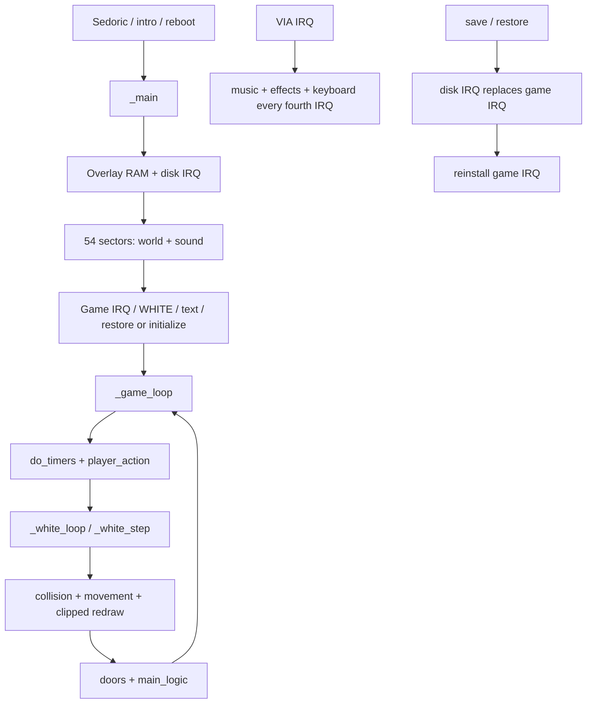

# Space: 1999 architecture

## 1. Scope and evidence

This is a static architecture of the pinned **published source**, supported by the local map/grammar comparisons described in [overview](overview.md). Source labels are upstream labels, not symbols recovered from the French executable. Exact loaded addresses of most linked routines remain unknown.

## 2. Module and toolchain provenance

[upstream `game source/osdk_config.bat:L8–L24`](https://github.com/Oric-Software-Development-Kit/Oric-Software/blob/c81612082482d1f497638ada14ad4640c5e4f1ec/games/Space%201999/Sources/game%20source/osdk_config.bat#L8-L24) orders header, NOISE, WHITE, game-specific map loader, graphics, disk, game/text, tail, frame and sound. XA syntax includes preprocessed constants and scoped local labels. `WHITE/mapload.s`, root `world.s`, `strings.s` and `world/soundovl.s` are alternate/older files in the archive; **the active list uses root `mapload.s`, `stringsc.s` and `world/world.s` through `worldall.s`**. Finding a routine in an archive does not establish that it is linked.

## 3. Environment and entry points

The game is configured at `$0500`; the intro at `$0600`. The wrapper `osdk_start` initializes software argument/stack pointer `sp` and jumps to `_main`; the game still calls engine functions through this C-compatible ABI. [upstream `game source/header.s:L17–L73`](https://github.com/Oric-Software-Development-Kit/Oric-Software/blob/c81612082482d1f497638ada14ad4640c5e4f1ec/games/Space%201999/Sources/game%20source/header.s#L17-L73).

Intro configuration selects C `main` and assembly helpers: [upstream `intro/osdk_config.bat:L7–L14`](https://github.com/Oric-Software-Development-Kit/Oric-Software/blob/c81612082482d1f497638ada14ad4640c5e4f1ec/games/Space%201999/Sources/intro/osdk_config.bat#L7-L14). The local README supplies the launch/reset sequence; we did not reconstruct `RUN99.COM` or prove the archived intro's identity.

## 4. Control flow and memory

`_main` registers hooks, switches overlay, initializes disk access, reads `NUM_SECT_MAP+16 = 54` sectors starting at zero-based sector 104 into `$C000`, installs the gameplay IRQ, initializes print/WHITE state, and asks whether to restore a game. [upstream `game source/sp1999.s:L453–L575`](https://github.com/Oric-Software-Development-Kit/Oric-Software/blob/c81612082482d1f497638ada14ad4640c5e4f1ec/games/Space%201999/Sources/game%20source/sp1999.s#L453-L575). The active contiguous load, not unused music-sector macro definitions, establishes sector progression.

`_game_loop` calls timers, player action, WHITE, doors and game logic; game over silences/plays audio and reboots. [upstream `game source/sp1999.s:L726–L781`](https://github.com/Oric-Software-Development-Kit/Oric-Software/blob/c81612082482d1f497638ada14ad4640c5e4f1ec/games/Space%201999/Sources/game%20source/sp1999.s#L726-L781).

Room transition clears display/maps, expands compact room data, places objects, initializes NOISE, draws the room directly, enables the small buffer and places characters, then invokes hooks. [upstream `game source/WHITE/white.s:L469–L561`](https://github.com/Oric-Software-Development-Kit/Oric-Software/blob/c81612082482d1f497638ada14ad4640c5e4f1ec/games/Space%201999/Sources/game%20source/WHITE/white.s#L469-L561). On movement, NOISE recalculates an affected rectangle and WHITE performs clear → redraw intersecting scene → copy rectangle. [upstream `game source/WHITE/white.s:L775–L783`](https://github.com/Oric-Software-Development-Kit/Oric-Software/blob/c81612082482d1f497638ada14ad4640c5e4f1ec/games/Space%201999/Sources/game%20source/WHITE/white.s#L775-L783); [upstream `game source/NOISE/spritemov.s:L71–L208`](https://github.com/Oric-Software-Development-Kit/Oric-Software/blob/c81612082482d1f497638ada14ad4640c5e4f1ec/games/Space%201999/Sources/game%20source/NOISE/spritemov.s#L71-L208).

| Region | Owner / purpose | Evidence and limits |
| --- | --- | --- |
| `$0000` onward | Software ABI pointers/temporaries, plus module-specific ZP | [upstream `game source/header.s:L17–L45`](https://github.com/Oric-Software-Development-Kit/Oric-Software/blob/c81612082482d1f497638ada14ad4640c5e4f1ec/games/Space%201999/Sources/game%20source/header.s#L17-L45); not a safe coexistence map for BASIC/ROM |
| `$0100–$01FF` | Hardware stack: JSR/IRQ frames, explicit saves and text tokens | NMOS 6502 architecture; maximum combined usage not established |
| `$0200–$02EF` | 240-byte scene buffer, six-byte row stride | [upstream `game source/NOISE/noise-start.s:L14–L25`](https://github.com/Oric-Software-Development-Kit/Oric-Software/blob/c81612082482d1f497638ada14ad4640c5e4f1ec/games/Space%201999/Sources/game%20source/NOISE/noise-start.s#L14-L25), [upstream `game source/NOISE/noise-start.s:L96–L108`](https://github.com/Oric-Software-Development-Kit/Oric-Software/blob/c81612082482d1f497638ada14ad4640c5e4f1ec/games/Space%201999/Sources/game%20source/NOISE/noise-start.s#L96-L108) |
| `$02F0` | `double_buff` flag, reserved BSS byte | Same source; overlaps system state if ROM/DOS remains active |
| `$0400–$04EF` | 240-byte occlusion buffer | Same source |
| `$0500` | Configured start of resident executable | Build configuration; no complete linked-size reconstruction |
| Linked resident data | Four 100-byte room layers; 100-byte sprite-location grid; three 20-byte coarse-coordinate arrays | [upstream `game source/WHITE/white.s:L29–L40`](https://github.com/Oric-Software-Development-Kit/Oric-Software/blob/c81612082482d1f497638ada14ad4640c5e4f1ec/games/Space%201999/Sources/game%20source/WHITE/white.s#L29-L40), [upstream `game source/NOISE/noise-start.s:L105–L114`](https://github.com/Oric-Software-Development-Kit/Oric-Software/blob/c81612082482d1f497638ada14ad4640c5e4f1ec/games/Space%201999/Sources/game%20source/NOISE/noise-start.s#L105-L114) |
| `$A000–$BF3F` | 200 × 40 HIRES byte area, including embedded attributes | [Atmos manual](https://library.defence-force.org/books/content/manual_atmos.pdf), graphics chapter |
| `$BF68–$BFDF` | Bottom 120 text bytes explicitly placed by frame source | [upstream `game source/frame.s:L512–L514`](https://github.com/Oric-Software-Development-Kit/Oric-Software/blob/c81612082482d1f497638ada14ad4640c5e4f1ec/games/Space%201999/Sources/game%20source/frame.s#L512-L514) |
| `$C000–$E5F9` | 9722-byte world data | Exact comparison in verification.json; source establishes base |
| `$E5FA–$E5FF` | Map padding to sector boundary | [upstream `game source/world/worldall.s:L24–L30`](https://github.com/Oric-Software-Development-Kit/Oric-Software/blob/c81612082482d1f497638ada14ad4640c5e4f1ec/games/Space%201999/Sources/game%20source/world/worldall.s#L24-L30) |
| `$E600` onward | Sound code and data after 38 map sectors | [upstream `game source/frame.s:L522–L536`](https://github.com/Oric-Software-Development-Kit/Oric-Software/blob/c81612082482d1f497638ada14ad4640c5e4f1ec/games/Space%201999/Sources/game%20source/frame.s#L522-L536) and `worldall.s`; last loaded byte `$F5FF`, not necessarily last used byte |
| `$FFFE–$FFFF` | Writable overlay IRQ vector | Disk/game installation routines |

The local README L126–L143 reports NOISE 5791 bytes, WHITE 3044, object images 4920, inventory images 672, backgrounds 10390, **English** compressed text 3725, world 9722 and music/effects 3997. These are author-reported figures; they are not a measured French linked map. The exact world size is independently confirmed.

Save/restore serializes two sectors from `__savegame_data_start`, beginning with magic `$C3`. The nominal end label lies after the five animated character picture entries; the actual transfer is fixed at 512 bytes. Backup sectors 102–103 precede restoration from 100–101. [upstream `game source/sp1999.s:L5325–L5474`](https://github.com/Oric-Software-Development-Kit/Oric-Software/blob/c81612082482d1f497638ada14ad4640c5e4f1ec/games/Space%201999/Sources/game%20source/sp1999.s#L5325-L5474). Bounds, compatibility and recovery after failed writes require executable-level tests.

## 5. Important interactions

The IRQ stores A/X/Y in separate zero-page bytes, executes CLD, acknowledges VIA Timer 1, processes audio and scans keyboard at one quarter of the IRQ cadence. It restores registers and RTIs. [upstream `game source/sp1999.s:L4687–L4759`](https://github.com/Oric-Software-Development-Kit/Oric-Software/blob/c81612082482d1f497638ada14ad4640c5e4f1ec/games/Space%201999/Sources/game%20source/sp1999.s#L4687-L4759). The initializer inherits the existing timer setup; 100 Hz is a source comment, not a frequency measured here.

Disk transfers switch handlers, disable VIA interrupt sources, poll DRQ with IRQ enabled, and use disk completion to escape the endless polling function via stack surgery. Save/restore reinstalls the gameplay handler. This excludes ordinary music/keyboard service during disk work.

## 6–10. Verification, limitations and next work

No build, emulator, hardware trace or frame-rate benchmark was performed. Exact byte matches cover world and grammar only. Prioritize linked addresses and compare all 512 save bytes against the labeled live-state interval; then trace dirty-region limits and interruption of foreground timers. For techniques and risks see [CPU](cpu-techniques.md), [hardware](hardware-techniques.md) and [findings](findings.md).
