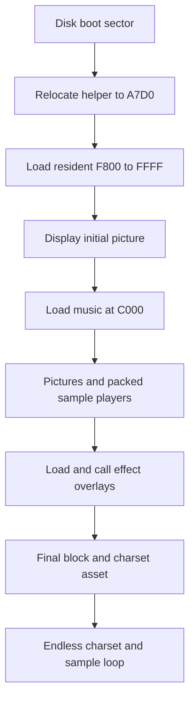

# Program architecture

## 4. Startup and control flow

The disk has 84 track records and 17 sectors per track. Payload order in the
extraction manifest is side, track, sector. The header and sector integrity are
confirmed independently of any filesystem interpretation.

Side 0, track 0, sector 2 starts at DSK `$000302`. Its first 23 bytes are header
data. The stub at DSK `$000319–$000341` installs RTS at `$00`, calls it and uses
TSX plus the retained return-address bytes to derive a source pointer, offset
by `$22`. It copies following bytes to `$A7D0` and jumps there. This recovers
position without relying on an original assembler symbol. The absolute load
address chosen by boot firmware is not established by executing the firmware;
the header contains `$B900/$B9E4`, which is insufficient alone to assert an ABI.
The relocation size comes from `$00AB`, another firmware-dependent input.

The relocated entry `$A7D0` corresponds to DSK `$000342`. It sets the IRQ vector
to `$A869`, selects sector 5, sets the eight-page count, reads sectors 5–12 into
`$F800–$FFFF`, selects upper RAM and jumps `$F800`. Instruction operand `$A832`
is incremented to move the read destination by a page. The loaded resident is
2,048 bytes; only `$F800–$FC00` is classified here as the main code/helpers.
Later bytes include descriptors, state, text and apparent DOS remnants.

R:$F800–$F987 is an explicit sequence of load, call, silence, timer setup, screen
clear and delay operations. `$FA9F` loads descriptor X and patches both the
sector destination and `$FAF7`'s JSR operand. `$FAF7` then calls the loaded address.
This is synchronous loading: SEI remains in effect during load and the byte
transfer polls `$0318`. Music is restored after selected loads, not shown to
continue concurrently throughout disk I/O.

Confirmed load order from literal X assignments:
`$14,$00,$01,$02,$03,$04,$05,$06,$07,$08,$09,$0A,$0B,$0D,$0E,$0F,$10,$11,$12,$13,$15`.
`$0C` has no load in this main sequence. `$00` is called explicitly at `$C000`;
`$0A` is an asset used with `$0B`; `$15` is a charset asset. `$13` is called later
through `$0FFD` after `$15` has changed the generic call target to `$B400`.

## Descriptor ledger

Five parallel arrays start at `$FC19` (sector), `$FC30` (encoded track), `$FC47`
(page count), `$FC5E` (load low) and `$FC74` (load high). X is a byte index, used
here only from `$00` to `$15`. Bit 7 of encoded track selects side 1. There is no
directory-name lookup in `$FA9F`.

| Index | Side:track:sector | Pages | Load range, inclusive | Classification / coverage |
| --- | --- | ---: | --- | --- |
| `$00` | 0:1:13 | 13 | `$C000–$CCFF` | Music initialization and IRQ examined; score format partly mapped |
| `$01` | 0:2:9 | 32 | `$1000–$2FFF` | Picture blitter and dormant delay |
| `$02` | 0:4:7 | 143 | `$0FFD–$9EFC` | JMP `$9D0D`; packed sample player examined |
| `$03` | 0:12:14 | 32 | `$1000–$2FFF` | Picture with the same blitter prefix |
| `$04` | 0:14:12 | 143 | `$0FFD–$9EFC` | Same player layout as `$02`, distinct sample bytes |
| `$05` | 0:23:2 | 34 | `$1000–$31FF` | Opposing picture-row transfers, selected prefix |
| `$06` | 0:25:2 | 13 | `$1000–$1CFF` | Picture/script transitions and scrolling, selected workers |
| `$07` | 0:25:15 | 56 | `$0600–$3DFF` | Compiler-style runtime and entry mapped; rest partial |
| `$08` | 0:29:3 | 13 | `$1000–$1CFF` | Picture/script transitions and blitter |
| `$09` | 0:29:16 | 32 | `$1000–$2FFF` | Picture; same basic blitter |
| `$0A` | 0:31:14 | 31 | `$D000–$EEFF` | Asset bank; not directly called |
| `$0B` | 0:33:11 | 138 | `$0600–$8FFF` | Interference/dancer workers examined; large module partial |
| `$0C` | 0:41:13 | 133 | Requested `$0600–$8AFF` | Uninvoked; only `$0600–$0AFF` recoverable by actual loader progression |
| `$0D` | 1:7:10 | 32 | `$1000–$2FFF` | Growing image reveal, 70 bytes of code then image |
| `$0E` | 1:9:8 | 133 | `$0600–$8AFF` | Full payload exists; compiler-style effect not deeply decoded |
| `$0F` | 1:17:5 | 32 | `$1000–$2FFF` | Picture; same basic blitter |
| `$10` | 1:19:3 | 26 | `$0600–$1FFF` | Compiler-style effect entry, partial |
| `$11` | 1:20:12 | 32 | `$1000–$2FFF` | Picture with a shorter blitter header |
| `$12` | 1:22:10 | 40 | `$0600–$2DFF` | Compiler-style effect entry, partial |
| `$13` | 1:24:16 | 137 | `$0FFD–$98FC` | Ending, JMP `$60CB`; local IRQ/sample and glyph composition examined |
| `$14` | 1:32:17 | 32 | `$1000–$2FFF` | Opening picture; same basic blitter |
| `$15` | 1:34:15 | 5 | `$B400–$B8FF` | Charset asset; source intended use partly inferred |

The source's sector increment rolls sector 18 to track+1, sector 1. Side
rollover occurs at track `$80`, **not at the image's 42-track boundary**.
Descriptor `$0C` therefore requests nonexistent side-0 track 42 after five
pages. Treating disk data as one linear host buffer would incorrectly splice
side-1 track 0 onto this module. Its absent call is evidence of dormancy in the
main sequence, not proof of a historical author mistake or release intention.

## Memory allocations and lifetime reuse

| Range | Owner / lifetime | Evidence |
| --- | --- | --- |
| `$F800–$FFFF` | Resident loader, tables and initial upper-memory image | Boot read destination and eight-page count |
| `$C000–$CCFF` | Music module while effects run | Descriptor `$00`, explicit `$C000` call, IRQ jump at `$024A` |
| `$D000–$EEFF` | Asset bank loaded before `$0B` | Descriptor `$0A`; surviving upper RAM must be verified at ending |
| `$0600`, `$0FFD`, `$1000` load slots | Sequential, mutually overwriting effects/assets | Descriptor ranges and order |
| `$0245–$024C` | Timer acknowledge and music jump trampoline | R:$F9C6–$FA12, M00:$C000–$C00F |
| `$0000–$00FF` | Entire page overwritten by sample relocation | M02:$9D4A–$9D6E |
| `$000A/$000B` | Sample pointer, also operands of IRQ LDA | Relocated sample listing |
| `$0010–$0047` | Ending copies 56 bytes here; executable IRQ body ends `$003F` | M13:$6223–$622B |
| `$0018/$0019`, `$0026`, `$003E` | Ending pointer, phase and saved A, inside code | Relocated final listing |
| `$0050–$0074` and beyond | Software frames / temporary values in examined effect | M0B:$0612–$069B and entry |
| `$A000–$BF3F` | HIRES area, frequently overwritten | Blitters and R:$FB1F–$FB86 |
| `$BFE0–$BFFA` | Music state arrays among other high RAM workspaces | M00 initialization / IRQ loads |
| `$BB80–$BFDF`, `$B3xx/$B4xx/$B8xx/$B9xx` | Ending text, masks and changing glyphs | M13:$60DE–$61C7 |

R:$FB08 clears the union `$BB80–$BFDF`, preserving music state at `$BFE0` onward.
It performs 1,280 stores but touches 1,120 unique bytes. R:$FB1F performs 8,192
stores to an 8,000-byte union `$A000–$BF3F`, preserving the area at `$BF40` onward.
The tail overlap is an explicit space/speed trade-off, not corruption inferred
from counting stores alone. R:$FB87 copies six charset pages to `$9900–$9FFF`
with holes, clears `$A000–$BFFF`, then sets a HIRES attribute. These are distinct
initialization lifetimes; a persistent allocation map would be misleading.

## Interrupts, input and dependencies

Three different IRQ regimes exist: configured disk escape handlers, a Timer 1
music trampoline, and sample playback code relocated to zero page. The ending
installs a fourth IRQ body at `$10`, saving A in an immediate operand. Vector
updates occur under SEI where inspected. The disk handlers are configured while
I is set; they are not demonstrated live IRQ paths. NMI ownership is unknown.

No interactive keyboard or tape path has been established in the reviewed live
sequence. DOS command strings and apparent ROM-call runtime helpers are present
but do not establish that these services execute. In particular M0B:$06B1 calls
`$DF8C`; with overlay RAM selected that address is not automatically a ROM call.
Complete effect reachability, boot firmware ABI, `$00AB`, initial VIA timer
counter phase and exact firmware workspace ownership remain outside static proof.
